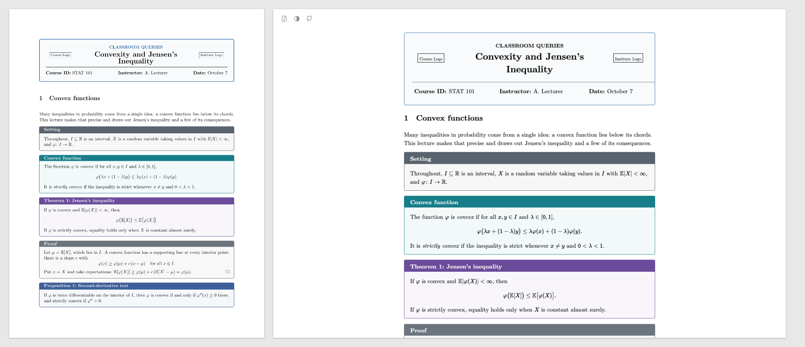

# tex8web

tex8web turns a LaTeX document into a web page that looks like its PDF. It is a configuration for [make4ht](https://ctan.org/pkg/make4ht), which comes with TeX Live. Most documents need no changes. MathJax typesets the math when you build, so the page is plain HTML and CSS. It works offline and reads without JavaScript.

**[See the examples](https://justin-w-li.github.io/tex8web/)**, each next to its PDF.



## What the page does

- Its fonts, headings, theorems, lists and boxes match the PDF.
- Its text is set for a screen: larger, ragged right, with space between paragraphs. One line in a config sets it as the PDF does.
- The table of contents sits beside the text, follows your place, and can be searched.
- Footnotes sit beside their paragraph.
- Pointing at a reference shows what it points to.
- It has light and dark themes, and fits a phone.
- It prints cleanly, and gives screen readers each formula in words.

## Compared with other tools

Plain make4ht gives tex4ht's default page, which looks little like the PDF. pandoc reads LaTeX itself and keeps only what it understands. LaTeXML emulates TeX, and needs a binding for each package to do well. lwarp loads its own package in the preamble. tex8web runs real TeX through tex4ht, then styles the result after the PDF's own measurements.

## Install

You need TeX Live with make4ht (tested with TeX Live 2026) and Node 22 or later, on macOS or Linux.

```sh
git clone https://github.com/justin-w-li/tex8web.git
cd tex8web
npm ci
```

Node only typesets the math at build time. [DOCUMENTATION.md](DOCUMENTATION.md) says what happens without it ("Without Node").

## Use

```sh
path/to/tex8web/bin/tex8web document.tex
```

The page and everything it uses go to `build/html/` beside the document. The folder is ready to publish as it is.

Most documents need nothing more. To link the page to the PDF, build the PDF first and pass its path with [`-p`](DOCUMENTATION.md#building-a-page). If the build warns about macros MathJax can't read, or you want a style of your own, write a short config: see [Your own config](DOCUMENTATION.md#your-own-config).

## Examples

[`examples/`](examples) has four documents from the Overleaf gallery. Each is under CC BY 4.0 and names its source at the top.

- `basic`: a short article with a figure, a table and a bibliography;
- `footnotes`: a law review article, heavy with footnotes;
- `custom`: class notes with their own colors and boxes, and a config;
- `complex`: a long, heavily customized document, which also shows tex8web's known gaps.

`npm run examples` builds each, with its PDF, into `examples/<name>/build/`, and the site that links them into `build/site/`.

## Documentation

- [DOCUMENTATION.md](DOCUMENTATION.md): building, configuring, what the page does, and known limitations.
- [CONTRIBUTING.md](CONTRIBUTING.md): how tex8web works, and how it is tested and released.

## License

MIT (see [LICENSE](LICENSE)). The fonts in `fonts/` are under the GUST Font License (see `fonts/LICENSE.txt`, which goes with every page).
